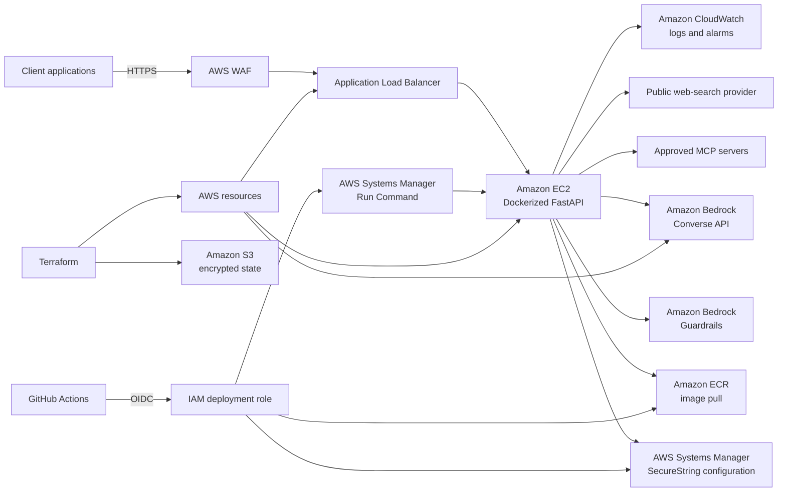

# Precision Agriculture Water Management RAG System

A domain-focused retrieval and reasoning platform for agricultural knowledge, irrigation planning, and water-resource decision support.

## Overview

This project builds a retrieval-augmented generation pipeline for precision agriculture and water management. It processes technical documents, indexes domain knowledge, and answers agriculture-related questions with source-aware retrieval and reasoning.

## Project Structure

```text
src/
  adapters/          API and CLI adapters
  agents/            domain agent implementations
  application/       application services and orchestration
  config/            runtime configuration and logging
  core/              domain entities, protocols, and exceptions
  document_processing/ document ingestion and semantic chunking
  embeddings/        embedding generation and vector stores
  generation/        generation and memory orchestration
  infrastructure/    external service integration, weather, persistence
  knowledge_graph/   knowledge-graph construction and traversal
  retrieval/         hybrid retrieval, routing, reranking, enhancement
  utils/             utility modules and evaluation helpers

tests/
  test_core.py       core regression tests

src/evaluation_data/
  evaluation gold set, seed dataset builder, and review notes
```

## Core Capabilities

- Domain-specific retrieval for irrigation, crop management, and water-use planning
- Hybrid retrieval combining semantic matching and keyword-based search
- Knowledge-graph traversal for relational agricultural questions
- Semantic document chunking and metadata-aware indexing
- Weather-aware context enrichment for agronomic decision support
- Evaluation modules for answer quality and agentic workflows

## Secure API

The supported HTTP entry point is `src.api.app:app`.

```bash
cp .env.example .env
# Set API_ADMIN_PASSWORD and a random JWT_SECRET of at least 32 characters.
uvicorn src.api.app:app --host 0.0.0.0 --port 8000
```

The API provides:

- `POST /auth/token` for short-lived JWT access tokens
- `POST /query` for authenticated RAG requests
- `POST /web/search` for bounded public web search
- `GET /mcp/{server_index}/tools` for allowlisted MCP server discovery
- `GET /health` for liveness

The API applies prompt-injection checks, request-size limits, credential redaction,
HTTPS/localhost restrictions for MCP endpoints, and explicit CORS configuration.
For production, use a managed secret store, HTTPS behind an ALB or reverse proxy,
and AWS Bedrock Guardrails in front of model responses.

## Agriculture agents

The platform includes ten deterministic, explainable decision-support agents under
[`src/agents/agriculture/`](src/agents/agriculture/):

| Agent | Responsibility |
| --- | --- |
| Crop disease | Produces a preliminary symptom assessment and requires agronomist confirmation before treatment |
| Irrigation | Calculates irrigation depth from evapotranspiration, rainfall, crop coefficient, and system efficiency |
| Pest monitoring | Compares trap counts and raises an integrated-pest-management warning |
| Soil health | Calculates nutrient deficits from laboratory values |
| Crop planning | Checks basic crop-rotation conflicts and planning constraints |
| Climate risk | Detects frost and heat-stress thresholds |
| Market intelligence | Calculates estimated net revenue from quantity, price, and costs |
| Traceability | Checks whether a harvest batch has a usable event timeline |
| Extension | Provides a safe localized-guidance starting point for RAG explanations |
| Farm copilot | Coordinates specialist assessments and propagates warnings and confirmation requirements |

All agents implement the shared contracts in
[`src/agents/agriculture/base.py`](src/agents/agriculture/base.py). Numeric decisions
are performed by deterministic functions in
[`src/agents/agriculture/services.py`](src/agents/agriculture/services.py); a model
can explain those results without becoming the source of truth for calculations.

Authenticated endpoints:

```text
GET  /agents
POST /agents/{agent_name}/run
```

Operational agents return `requires_confirmation: true` when a recommendation could
affect equipment, chemicals, farm records, or other external systems.

## Deployment

- `Dockerfile` and `docker-compose.yml` provide a non-root, read-only container baseline.
- `.github/workflows/ci-cd.yml` runs tests, audits dependencies, publishes to Amazon ECR,
  and deploys to EC2 through AWS Systems Manager.
- `infra/terraform` provisions the EC2 instance, HTTPS Application Load Balancer, ECR,
  WAF, CloudWatch alarms, IAM roles, OIDC deployment trust, and Bedrock permissions.

The CI/CD workflow uses AWS OIDC, so configure `AWS_DEPLOY_ROLE_ARN` and
`EC2_INSTANCE_ID`. Terraform does not create application
secrets; provision `/opt/agriculture-rag/.env` through SSM or Secrets Manager.

Terraform deployment instructions, state bootstrap, SSM configuration, and GitHub
environment setup are documented in [infra/terraform/README.md](infra/terraform/README.md).

## Security references

The implementation follows the security guidance from:

- [FastAPI OAuth2 and JWT documentation](https://fastapi.tiangolo.com/tutorial/security/oauth2-jwt/)
- [AWS Bedrock Converse API](https://docs.aws.amazon.com/bedrock/latest/userguide/conversation-inference.html)
- [AWS Bedrock Guardrails](https://docs.aws.amazon.com/bedrock/latest/userguide/guardrails.html)
- [Model Context Protocol authorization](https://modelcontextprotocol.io/specification/latest/basic/authorization)
- [OWASP GenAI Security Project](https://genai.owasp.org/)

## Features

### Document processing
- PDF extraction and fallback handling for common document pipelines
- Semantic chunking and document segmentation
- Region-aware and crop-aware metadata tagging
- Operational support for agronomy source documents

### Retrieval
- Hybrid search using semantic embeddings and BM25-style keyword matching
- Intent-aware query routing
- Query enhancement and reranking for higher precision
- Sentence-window retrieval for tight source context

### Knowledge graph
- Entity extraction for agricultural concepts
- Relationship traversal and contextual graph search
- Support for multi-hop reasoning on knowledge relationships

### Generation and orchestration
- LLM integration for generation and decomposition
- Iterative reasoning and multi-step retrieval loops
- Structured answer generation with citations and confidence scoring
- Weather and location-aware context injection

### Evaluation
- LLM-as-a-judge style evaluation patterns
- Agentic evaluation and calibration utilities
- Golden-set dataset support for agronomy QA benchmarking

---

## Architecture

### Proposed AWS Architecture

The proposed production topology keeps the application host private, terminates TLS
at the load balancer, and uses IAM roles instead of long-lived AWS access keys.



### AWS service icon legend

The icons below use the official AWS Architecture Icons asset paths. The complete
icon set and usage guidance are available from the
[AWS Architecture Icons](https://aws.amazon.com/architecture/icons/) page.

| Service | Role | Icon |
|---|---|---|
| Amazon EC2 | Private compute host for the containerized API |  |
| Elastic Load Balancing | Public HTTPS entry point and TLS termination |  |
| AWS WAF | Layer-7 rate limiting and request filtering |  |
| Amazon Bedrock | Foundation-model inference | [AWS service icon catalog](https://aws.amazon.com/architecture/icons/) |
| Amazon ECR | Immutable container image storage and scanning |  |
| AWS Systems Manager | Secure deployment commands and configuration retrieval |  |
| Amazon CloudWatch | Application logs, metrics, and alarms |  |
| Amazon S3 | Encrypted Terraform state with versioning and locking |  |
| AWS Identity and Access Management | EC2, OIDC, and least-privilege deployment roles |  |

### Request and deployment flows

1. A client sends an HTTPS request to the public ALB.
2. AWS WAF applies the edge rate limit before traffic reaches the application.
3. The ALB terminates TLS and forwards traffic to the private EC2 target on port 8000.
4. FastAPI validates JWT or OIDC claims and applies request-level guardrails.
5. The provider layer calls either the local RAG pipeline or Bedrock Converse.
6. Bedrock Guardrails filter model input and output when configured.
7. MCP requests are limited to explicitly allowlisted servers and approved network
   destinations.
8. GitHub Actions authenticates through OIDC, pushes the image to ECR, and invokes
   Systems Manager Run Command on the EC2 instance.
9. The instance retrieves its encrypted environment payload from SSM and restarts
   the container with a read-only filesystem.
10. Logs and operational alarms are sent to CloudWatch.

### Architecture boundaries

- **Public boundary:** WAF and ALB only.
- **Private application boundary:** EC2, container runtime, and internal target group.
- **Model boundary:** Bedrock Converse and Bedrock Guardrails.
- **Deployment boundary:** GitHub OIDC role and Systems Manager.
- **State boundary:** Versioned, encrypted S3 Terraform state.
- **Tool boundary:** Explicit MCP server allowlist and web-search adapter.

## Code Documentation

The implementation is organized into layers so the API, domain logic, providers, and
infrastructure can be documented and tested independently.

| Area | Primary files | Responsibility |
|---|---|---|
| API composition | [src/api/app.py](src/api/app.py), [src/api/models.py](src/api/models.py) | FastAPI application factory, routes, request and response schemas |
| Agriculture agents | [src/agents/agriculture/](src/agents/agriculture/) | Shared contracts, deterministic calculators, ten specialist agents, and registry |
| Authentication | [src/api/auth.py](src/api/auth.py), [src/api/settings.py](src/api/settings.py) | Local JWT issuance, OIDC JWT validation, configuration validation |
| Guardrails | [src/api/guardrails.py](src/api/guardrails.py), [src/api/guardrails_policy.py](src/api/guardrails_policy.py) | Input validation, prompt-injection checks, secret redaction, policy defaults |
| Providers | [src/api/providers.py](src/api/providers.py) | Provider-neutral generation interface for local RAG and Bedrock |
| External tools | [src/api/mcp.py](src/api/mcp.py), [src/api/web_search.py](src/api/web_search.py) | Allowlisted MCP requests and bounded web search |
| Domain layer | [src/core/](src/core/) | Entities, protocols, and domain exceptions |
| Retrieval | [src/retrieval/](src/retrieval/) | Query routing, hybrid retrieval, reranking, and query enhancement |
| Ingestion | [src/document_processing/](src/document_processing/) | PDF extraction, semantic chunking, and metadata preparation |
| Deployment | [infra/terraform/](infra/terraform/), [.github/workflows/ci-cd.yml](.github/workflows/ci-cd.yml) | AWS resources, state bootstrap, CI/CD, image build, and deployment |

All new production modules include module and public-function docstrings. The
[tests/test_api_security.py](tests/test_api_security.py) file documents the expected
security boundary through executable tests.

### Application architecture

```
┌─────────────────────────────────────────────────────────────────────────────┐
│                           PRECISION AGRICULTURE RAG                          │
├─────────────────────────────────────────────────────────────────────────────┤
│  ┌─────────────┐  ┌─────────────┐  ┌─────────────┐  ┌─────────────────────┐ │
│  │   FastAPI   │  │     CLI     │  │  Notebook   │  │   Query Interface   │ │
│  │   Server    │  │  Interface  │  │  Interface  │  │     (Interactive)   │ │
│  └──────┬──────┘  └──────┬──────┘  └──────┬──────┘  └──────────┬──────────┘ │
│         │                │                │                    │            │
│         └────────────────┴────────────────┴────────────────────┘            │
│                                    │                                         │
│                           ┌────────▼────────┐                               │
│                           │  RAG Orchestrator│                               │
│                           │   (ReAct Loop)   │                               │
│                           └────────┬────────┘                               │
│                                    │                                         │
│         ┌──────────────────────────┼──────────────────────────┐             │
│         │                          │                          │             │
│  ┌──────▼──────┐           ┌───────▼───────┐          ┌───────▼───────┐    │
│  │   Query     │           │    Hybrid     │          │   Knowledge   │    │
│  │   Router    │           │   Retriever   │          │     Graph     │    │
│  │  (Intent)   │           │ (Semantic+BM25)│          │   (NetworkX)  │    │
│  └─────────────┘           └───────┬───────┘          └───────────────┘    │
│                                    │                                         │
│                    ┌───────────────┼───────────────┐                        │
│                    │               │               │                        │
│             ┌──────▼──────┐ ┌──────▼──────┐ ┌──────▼──────┐                │
│             │   Query     │ │   Cross-    │ │  Sentence   │                │
│             │  Enhancer   │ │  Encoder    │ │   Window    │                │
│             │ (Multi-Q)   │ │  Reranker   │ │  Retriever  │                │
│             └─────────────┘ └─────────────┘ └─────────────┘                │
│                                    │                                         │
│                           ┌────────▼────────┐                               │
│                           │   RAG Chain     │                               │
│                           │   (LangChain)   │                               │
│                           └────────┬────────┘                               │
│                                    │                                         │
│                           ┌────────▼────────┐                               │
│                           │     Ollama      │                               │
│                           │  (Llama 3/Qwen) │                               │
│                           └─────────────────┘                               │
├─────────────────────────────────────────────────────────────────────────────┤
│  ┌─────────────────────────────────────────────────────────────────────┐   │
│  │                          DATA LAYER                                  │   │
│  ├─────────────┬──────────────┬─────────────────┬─────────────────────┤   │
│  │  ChromaDB   │  Knowledge   │    Semantic     │   Embedding Cache   │   │
│  │ VectorStore │    Graph     │     Chunks      │      (Pickle)       │   │
│  └─────────────┴──────────────┴─────────────────┴─────────────────────┘   │
└─────────────────────────────────────────────────────────────────────────────┘
```

### Directory Structure

```
├── src/
│   ├── adapters/                 # Interface adapters
│   │   ├── api/                  # FastAPI REST server
│   │   └── cli/                  # Command-line interface
│   ├── application/              # Application layer
│   │   ├── agents/               # GA-RAG agent implementation
│   │   └── evaluation/           # LLM-as-Judge evaluators
│   ├── config/                   # Configuration management
│   ├── core/                     # Core entities and interfaces
│   ├── document_processing/      # PDF processing & chunking
│   ├── embeddings/               # Embedding generation & vector store
│   ├── generation/               # LLM generation & memory
│   ├── infrastructure/           # Infrastructure (LLM clients, persistence)
│   ├── knowledge_graph/          # Entity extraction & graph building
│   ├── retrieval/                # Hybrid retrieval pipeline
│   └── utils/                    # Utility functions
├── data/                         # Generated data
│   ├── vector_store/             # ChromaDB persistent storage
│   ├── knowledge_graph/          # Graph serialization
│   ├── processed_chunks/         # Chunked document data
│   └── embedding_cache/          # Cached embeddings
├── documents/                    # Source PDF documents
├── tests/                        # Unit & integration tests
├── notebooks/                    # Jupyter notebooks
└── logs/                         # Application logs
```

---

## Installation

### Prerequisites

- Python 3.12+
- [Ollama](https://ollama.ai/) installed and running
- 16GB RAM recommended (4GB VRAM for GPU acceleration)

### Setup

1. **Clone the repository**
```bash
git clone https://github.com/yourusername/precision-agriculture-rag.git
cd precision-agriculture-rag
```

2. **Run setup script**
```bash
chmod +x setup.sh
./setup.sh
```

Or manually:
```bash
python -m venv rag_env
source rag_env/bin/activate
pip install -r requirements.txt
python -m spacy download en_core_web_sm
```

3. **Pull LLM model with Ollama**
```bash
ollama pull llama3.2:3b
# Or for better quality:
ollama pull gemma2:9b
```

4. **Add documents**
Place PDF files in the `documents/` folder, organized by category:
```
documents/
├── 01_core_water_agriculture/
├── 02_precision_agriculture_tech/
├── 03_irrigation_systems/
└── ...
```

5. **Ingest documents**
```bash
python src/ingest.py
```

---

## Usage

### Interactive CLI

```bash
python src/main.py
```

Commands:
- `/react` - Use ReAct reasoning (structured output)
- `/eval` - Evaluate last response
- `/clear` - Clear conversation memory
- `/quit` - Exit

### Single Query

```bash
python src/main.py --query "What are the best practices for drip irrigation?"
```

### REST API

```bash
./start_api.sh
# Or:
uvicorn src.adapters.api.server:app --reload
```

API Endpoints:
- **Swagger UI**: http://localhost:8000/docs
- **ReDoc**: http://localhost:8000/redoc
- `POST /query` - Query the RAG system
- `GET /health` - Health check
- `GET /info` - System information

### Python SDK

```python
from src.main import PrecisionAgricultureRAG

rag = PrecisionAgricultureRAG()

response = rag.query(
    question="How does soil moisture affect irrigation scheduling?",
    top_k=5,
    use_reranking=True
)

print(response["answer"])
print(f"Confidence: {response['confidence']:.0%}")
```

---

## Core Concepts & Techniques

### 1. Document Processing

**Module**: `src/document_processing/processor.py`

The document processor handles PDF extraction with intelligent table detection and text cleaning.

#### Features
- **Dual extraction engines**: pdfplumber (primary) with pypdf fallback
- **Table detection**: Structured table data converted to text format
- **Text normalization**: Quote normalization, whitespace cleanup, header/footer removal

#### Pipeline
```
PDF → Page Extraction → Table Detection → Text Cleaning → Chunk Generation
```

#### Metadata Extraction
Each chunk includes:
- Source document name
- Category (from folder structure)
- Page number
- Chunk index
- Topic tags (domain-specific keywords)

---

### 2. Semantic Chunking

**Module**: `src/document_processing/semantic_chunker.py`

Implements **SemanticContextAgent v2.0** - an agentic proposition-based semantic splitter.

#### Configuration
```python
SEMANTIC_CHUNK_CONFIG = {
    "target_token_range": [200, 500],      # Target chunk size in tokens
    "min_chunk_chars": 800,                 # ~200 tokens
    "max_chunk_chars": 2000,                # ~500 tokens
    "overlap_percent": 0.10,                # 10% semantic bridge
    "breakpoint_threshold_percentile": 95,  # For semantic breaking
    "similarity_drop_threshold": 0.15,      # Topic shift detection
}
```

#### Algorithm: Semantic Similarity Change Point Detection

The chunker uses **embedding-based topic boundary detection**:

1. **Propositional Split**: Text → Sentences (atomic units)
2. **Embedding Generation**: Each sentence → 384-dim vector
3. **Similarity Calculation**: Consecutive sentence cosine similarity
4. **Breakpoint Detection**: Identify where dissimilarity > threshold

**Mathematical Formula:**

```
breakpoint_i = 1  if (1 - sim(s_i, s_{i+1})) >= percentile_95
             = 0  otherwise
```

Where cosine similarity:
```
sim(s_i, s_{i+1}) = (e_i · e_{i+1}) / (||e_i|| × ||e_{i+1}||)
```

#### Sliding Window Change Point Detection

Uses a sliding window (W=3) with statistical threshold:

```
Boundary Trigger: sim(s_i, s_{i+1}) < μ - (k × σ)
```

Where:
- μ = local mean similarity in window
- σ = local standard deviation
- k ∈ [1.5, 2.0] = threshold multiplier

#### Features Implemented

| Feature | Description |
|---------|-------------|
| **Contextual Chunk Headers** | `[Document: X] [Section: Y] [Page: Z]` prepended to each chunk |
| **Sliding Windows** | Configurable window/stride for overlapping views |
| **Hierarchical Chunking** | Document → Section → Chunk → Sentence levels |
| **Sentence-Window Retrieval** | Store N sentences before/after for context expansion |
| **Intent Classification** | Technical, Instructional, or Conceptual labeling |

#### Chunking Quality Metrics

The `ChunkingEvaluator` class implements mathematical evaluation:

| Metric | Formula | Description |
|--------|---------|-------------|
| **Boundary Clarity** | ∇sim_i = sim(S_i, S_{i+1}) - sim(S_{i-1}, S_i) | Gradient of cosine similarity |
| **Chunk Stickiness** | σ²_inter / σ²_intra | Inter-chunk vs intra-chunk variance ratio |
| **CIG Score** | H(chunk) - Σ MI(chunk, others) | Contextual Information Gain |

**Stickiness Formula:**
```
Stickiness = Var(inter-chunk similarities) / Var(intra-chunk similarities)
```

Higher stickiness = better chunk cohesion.

---

### 3. Embedding Generation

**Module**: `src/embeddings/generator.py`

#### Model: all-MiniLM-L6-v2
- **Dimensions**: 384
- **Speed**: Optimized for real-time inference
- **Normalization**: L2 normalized for cosine similarity

#### Features
- **GPU Acceleration**: CUDA support when available
- **Batch Processing**: Configurable batch size (default: 32)
- **Caching**: Disk-based embedding cache using MD5 hashing

```python
EMBEDDING_CONFIG = {
    "model_name": "all-MiniLM-L6-v2",
    "device": "cuda",  # or "cpu"
    "batch_size": 32,
    "normalize_embeddings": True,
}
```

#### Similarity Computation

For normalized embeddings, **dot product = cosine similarity**:

```
similarity(q, d) = q · d = cos(θ)
```

---

### 4. Vector Store

**Module**: `src/embeddings/vector_store.py`

#### ChromaDB Configuration
```python
VECTOR_STORE_CONFIG = {
    "type": "chroma",
    "collection_name": "water_management_docs",
    "distance_metric": "cosine",
    "embedding_dimension": 384,
}
```

#### HNSW Index

ChromaDB uses **Hierarchical Navigable Small World (HNSW)** graphs for approximate nearest neighbor search:

- **Time Complexity**: O(log N) per query
- **Space Complexity**: O(N × M) where M = connections per node

---

### 5. Hybrid Retrieval

**Module**: `src/retrieval/hybrid_retriever.py`

Combines **semantic search** (embeddings) with **keyword search** (BM25) using fusion algorithms.

#### BM25 (Best Matching 25)

BM25 scoring for keyword search:

```
BM25(D, Q) = Σ IDF(q_i) × [f(q_i, D) × (k₁ + 1)] / [f(q_i, D) + k₁ × (1 - b + b × |D|/avgdl)]
```

Where:
- f(q_i, D) = term frequency in document
- |D| = document length
- avgdl = average document length
- k₁ = 1.2 (term frequency saturation)
- b = 0.75 (length normalization)

#### Inverse Document Frequency:
```
IDF(q_i) = ln[(N - n(q_i) + 0.5) / (n(q_i) + 0.5) + 1]
```

#### Reciprocal Rank Fusion (RRF)

Combines multiple ranking lists:

```
RRF_score(d) = Σ 1 / (k + rank_r(d))
```

Where:
- R = set of rankings (semantic, keyword)
- k = 60 (constant to prevent high-ranked dominance)
- rank_r(d) = position of document d in ranking r

#### Weighted Fusion

Alternative fusion using normalized scores:

```
combined(d) = α × [semantic(d)/max(semantic)] + (1-α) × [keyword(d)/max(keyword)]
```

Default: α = 0.7 (70% semantic, 30% keyword)

---

### 6. Query Enhancement

**Module**: `src/retrieval/query_enhancer.py`

#### Multi-Query Generation

Uses LLM to generate diverse query reformulations:

```
Original: "How to save water in irrigation?"
→ Query 1: "What are water conservation techniques for irrigation systems?"
→ Query 2: "Methods to reduce water usage in agricultural irrigation"
→ Query 3: "Efficient irrigation practices for water savings"
```

#### Domain-Specific Query Expansion

Adds synonyms from agricultural vocabulary:

```python
DOMAIN_SYNONYMS = {
    "irrigation": ["watering", "water application"],
    "drip": ["trickle", "micro-irrigation"],
    "efficiency": ["productivity", "optimization"],
    "evapotranspiration": ["ET", "ET0", "water loss"],
}
```

---

### 7. Cross-Encoder Reranking

**Module**: `src/retrieval/reranker.py`

#### Model: cross-encoder/ms-marco-MiniLM-L-6-v2

Cross-encoders process query-document pairs jointly, providing more accurate relevance scores than bi-encoders.

#### Architecture Comparison

| Bi-Encoder | Cross-Encoder |
|------------|---------------|
| Query → Embedding | (Query, Document) → Score |
| Document → Embedding | Joint attention |
| Dot product similarity | Classification head |
| Fast (separate encoding) | Slow (pair-wise) |
| Used for recall | Used for precision |

#### Two-Stage Retrieval

```
Stage 1: Bi-encoder retrieves top-20 candidates (fast)
Stage 2: Cross-encoder reranks to top-5 (precise)
```

---

### 8. Query Routing

**Module**: `src/retrieval/query_router.py`

Intelligent classification of query intent to select optimal retrieval strategy.

#### Query Intents

| Intent | Pattern | Strategy |
|--------|---------|----------|
| FACTUAL | "What is...", "Define..." | Vector search, high semantic weight |
| RELATIONAL | "How are X and Y related?" | Graph traversal, multi-hop |
| SUMMARY | "Summarize...", "Overview of..." | Vector search, more documents |
| REASONING | "Why...", "Analyze..." | Hybrid + Graph, 2-hop depth |
| PROCEDURAL | "How to...", "Steps to..." | Vector + Keyword |
| COMPARATIVE | "Compare X and Y" | Hybrid + Graph |

#### Retrieval Strategy Configuration

```python
@dataclass
class RetrievalStrategy:
    use_vector: bool = True
    use_keyword: bool = True
    use_graph: bool = False
    graph_depth: int = 1
    top_k: int = 5
    semantic_weight: float = 0.7
    use_reranking: bool = True
```

---

### 9. Knowledge Graph

**Module**: `src/knowledge_graph/graph_builder.py`

#### Entity Types

| Type | Examples |
|------|----------|
| irrigation_method | drip irrigation, sprinkler, center pivot |
| crop | wheat, tomato, olive, citrus |
| sensor | soil moisture sensor, tensiometer, TDR |
| technology | precision agriculture, IoT, remote sensing |
| water_source | groundwater, reservoir, aquifer |
| metric | evapotranspiration, water use efficiency |
| region | arid, Mediterranean, Morocco basins |
| organization | FAO, USDA, ICARDA |

#### Entity Extraction

1. **Pattern-Based**: Agricultural domain regex patterns
2. **SpaCy NER**: Named entity recognition for organizations, locations
3. **Hybrid**: Combines both methods with deduplication

#### Relationship Extraction

- **Co-occurrence**: Entities in same sentence
- **Dependency Parsing**: Subject-verb-object triples
- **Proximity**: Entities within 500 characters

#### Graph Queries

**Ego Graph Retrieval:**
```python
def query_entity(entity: str, max_depth: int = 2):
    subgraph = nx.ego_graph(self.graph, entity, radius=max_depth)
    # Returns neighbors, predecessors, relationships
```

#### Graph Metrics

- **Nodes**: Unique entities
- **Edges**: Entity relationships
- **Connected Components**: Isolated subgraphs
- **Average Degree**: Relationship density

---

### 10. RAG Chain & Generation

**Module**: `src/generation/rag_chain.py`

#### Prompt Engineering

Uses Llama 3 chat format with structured sections:

```
<|begin_of_text|><|start_header_id|>system<|end_header_id|>
{system_prompt}
<|eot_id|><|start_header_id|>user<|end_header_id|>
{conversation_history}
RETRIEVED CONTEXT:
{context}
KNOWLEDGE GRAPH CONTEXT:
{kg_context}
QUESTION: {question}
<|eot_id|><|start_header_id|>assistant<|end_header_id|>
```

#### System Prompt

Specialized for agricultural advisory:
- Irrigation systems and scheduling
- Soil moisture management
- Water conservation techniques
- IoT sensors and monitoring
- Crop-specific water requirements

#### Confidence Scoring

Heuristic-based confidence estimation:

```python
confidence = 0.5  # Base

# More sources → higher confidence
if num_docs >= 3:
    confidence += 0.2

# Citations in response → higher confidence
if "[Source:" in response:
    confidence += 0.1

# Uncertainty phrases → lower confidence
if "not sure" in response.lower():
    confidence -= 0.15
```

#### Conversation Memory

Sliding window memory (last 5 exchanges):

```python
MEMORY_CONFIG = {
    "type": "conversation_buffer_window",
    "k": 5,
    "memory_key": "chat_history",
}
```

---

### 11. ReAct Orchestration

**Module**: `src/generation/rag_orchestrator.py`

Implements **ReAct (Reasoning + Acting)** pattern for multi-step reasoning.

#### ReAct Loop

```
1. THOUGHT: Analyze what information is needed
2. ACTION: Choose and call a retrieval tool
3. OBSERVATION: Analyze the results
4. CRITIQUE: Decide if more information is needed
5. (Repeat until sufficient context gathered)
6. SYNTHESIZE: Generate final answer
```

#### Available Tools

| Tool | Description | Best For |
|------|-------------|----------|
| `vector_search(query, top_k)` | Semantic similarity search | Facts, definitions |
| `graph_search(entities, depth)` | Multi-hop entity traversal | Relationships, hierarchies |
| `keyword_search(query)` | BM25 exact matching | Technical terms, IDs |
| `get_document_summary(doc_id)` | Document overview | Big-picture context |

#### Structured Output Format

```markdown
## Executive Summary
Brief 2-3 sentence overview

## Detailed Findings
1. Finding with [Source: document_name]
2. Another finding with citation

## Sources
| # | Document | Relevance |
|---|----------|-----------|
| 1 | doc.pdf  | High      |
```

---

### 12. Graph-Based Agentic RAG (GA-RAG)

**Module**: `src/application/agents/rag_agent.py`

Advanced agentic architecture with autonomous decision-making.

#### Three Phases

**Phase 1: Query Decomposition**
- Break complex queries into sub-problems
- Classify each as: FACTUAL, RELATIONAL, COMPARATIVE, PROCEDURAL
- Extract entities for graph traversal

**Phase 2: Tool Selection**
- Route sub-queries to optimal retrieval tool
- RELATIONAL → Graph search
- FACTUAL → Vector search
- Mixed → Hybrid approach

**Phase 3: Iterative Synthesis**
- Execute tools in sequence
- Accumulate context
- Refine until quality threshold met

#### Stateful Memory (Loop Prevention)

```python
@dataclass
class AgentState:
    visited_entities: Set[str]      # Prevent re-visiting
    traversal_paths: List[List[str]]  # Track exploration
    retrieval_attempts: int         # Max iterations guard
    max_attempts: int = 5           # Hard limit
    context_buffer: List[str]       # Accumulated context
```

#### Query Decomposition Example

```
Input: "How does drip irrigation affect water efficiency, and 
        what sensors are used to monitor soil moisture?"

Decomposition:
1. FACTUAL: "What is drip irrigation?" | ENTITIES: drip irrigation
2. RELATIONAL: "How does drip irrigation affect water efficiency?" 
   | ENTITIES: drip irrigation, water efficiency
3. FACTUAL: "What sensors monitor soil moisture?" 
   | ENTITIES: sensors, soil moisture
```

---

### 13. LLM-as-Judge Evaluation

**Modules**: `src/application/evaluation/rag_eval.py`, `src/utils/evaluator.py`

Implements multiple evaluation judges for RAG quality assessment.

#### Evaluation Metrics

| Metric | Description | Formula |
|--------|-------------|---------|
| **Faithfulness** | Claims supported by context | supported_claims / total_claims |
| **Answer Relevancy** | Response addresses question | LLM judgment [0-10] |
| **Context Relevancy** | Retrieved context is useful | LLM judgment [0-10] |
| **Context Precision** | Relevant docs ranked higher | AP@k |
| **Context Recall** | All relevant info retrieved | Coverage assessment |

#### Agricultural-Specific Judges

**AgriculturalAccuracyJudge:**
- Numerical accuracy (measurements, units)
- Technical term correctness
- Practical applicability for farmers
- Regional appropriateness

**SafetyJudge:**
- No incorrect irrigation volumes
- No wrong chemical concentrations
- No soil degradation risks
- Appropriate caveats included

#### Verdict Types

```python
class VerdictType(Enum):
    PASS = "PASS"       # Score ≥ 0.7
    MARGINAL = "MARGINAL"  # 0.4 ≤ Score < 0.7
    FAIL = "FAIL"       # Score < 0.4
```

#### Evaluation Report Example

```json
{
  "scores": {
    "faithfulness": {"score": 0.85, "reason": "All claims supported"},
    "answer_relevancy": {"score": 0.9, "reason": "Direct answer"},
    "agricultural_accuracy": {"score": 0.8, "reason": "Correct metrics"}
  },
  "overall_score": 0.85,
  "verdict": "PASS",
  "recommendations": []
}
```

---

### 14. Mathematical Foundations

#### Cosine Similarity

Core similarity measure for embedding comparison:

```
cos(u, v) = (u · v) / (||u|| × ||v||) = Σ(u_i × v_i) / (√Σu_i² × √Σv_i²)
```

#### Normalized Dot Product

For L2-normalized embeddings:
```
if ||u|| = ||v|| = 1:  cos(u, v) = u · v
```

#### Euclidean Distance to Cosine

For normalized vectors:
```
||u - v||² = 2(1 - cos(u, v))
```

#### Information Entropy

Used in CIG (Contextual Information Gain) calculation:

```
H(X) = -Σ p(x_i) × log(p(x_i))
```

Approximated via vocabulary diversity:
```
H_hat(chunk) = |unique_words| / |total_words| × min(1, |words|/200)
```

#### Mutual Information

For measuring redundancy between chunks:

```
MI(X; Y) ≈ cosine_similarity(X, Y)
```

High MI = High redundancy (bad for chunk diversity)

#### Variance Calculations

**Intra-chunk variance** (should be low for cohesion):
```
σ²_intra = (1/|C|) × Σ Var({sim(s_i, s_j) : s_i, s_j ∈ c})
```

**Inter-chunk variance** (should be high for separation):
```
σ²_inter = Var({sim(c_i, c_{i+1}) : i = 1, ..., n-1})
```

#### Gradient for Boundary Detection

```
∇sim_i = sim(S_i, S_{i+1}) - sim(S_{i-1}, S_i)
```

Negative gradient indicates topic shift (good boundary location).

---

## API Reference

### REST Endpoints

#### POST /query
Query the RAG system.

**Request:**
```json
{
  "question": "What are the best practices for drip irrigation?",
  "top_k": 5,
  "use_reranking": true,
  "use_agent": false
}
```

**Response:**
```json
{
  "answer": "Drip irrigation best practices include...",
  "sources": ["irrigation_guide.pdf", "water_management.pdf"],
  "confidence": 0.85,
  "query_time_ms": 1234.5,
  "tools_used": ["vector_search", "reranker"]
}
```

#### GET /health
Check system health.

**Response:**
```json
{
  "status": "healthy",
  "version": "2.0.0",
  "components": {
    "rag_system": true,
    "vector_store": true,
    "knowledge_graph": true
  }
}
```

#### GET /info
Get system information.

**Response:**
```json
{
  "vector_store_count": 1523,
  "knowledge_graph_nodes": 456,
  "knowledge_graph_edges": 892,
  "embedding_model": "all-MiniLM-L6-v2",
  "llm_model": "llama3.2:3b"
}
```

---

## Configuration

### Environment Variables

Create a `.env` file:

```bash
# LLM Configuration
LLM_MODEL=llama3.2:3b
LLM_BASE_URL=http://localhost:11434
LLM_TEMPERATURE=0.3

# Embedding Configuration
EMBEDDING_DEVICE=cuda  # or cpu

# API Configuration
API_HOST=0.0.0.0
API_PORT=8000
```

### Key Configuration Files

| File | Purpose |
|------|---------|
| `src/config/config.py` | Central configuration |
| `pytest.ini` | Test configuration |
| `requirements.txt` | Python dependencies |

### LLM Configuration

```python
LLM_CONFIG = {
    "model": "llama3.2:3b",
    "base_url": "http://localhost:11434",
    "temperature": 0.3,
    "top_p": 0.9,
    "top_k": 40,
    "num_ctx": 4096,
    "repeat_penalty": 1.2,
    "num_predict": 512,
}
```

### Retrieval Configuration

```python
RETRIEVAL_CONFIG = {
    "hybrid_search": {
        "enabled": True,
        "semantic_weight": 0.7,
        "keyword_weight": 0.3,
        "top_k_semantic": 20,
        "top_k_keyword": 10,
    },
    "multi_query": {
        "enabled": True,
        "num_queries": 3,
        "aggregation_method": "reciprocal_rank_fusion",
    },
    "reranking": {
        "enabled": True,
        "model": "cross-encoder/ms-marco-MiniLM-L-6-v2",
        "top_k_initial": 20,
        "top_k_final": 5,
    },
    "final_top_k": 5,
}
```

---

## Testing

### Run Tests

```bash
# All tests
pytest

# With coverage
pytest --cov=src tests/

# Specific test
pytest tests/test_core.py::TestChunkingEvaluator

# Verbose output
pytest -v tests/
```

### Test Categories

| Module | Tests |
|--------|-------|
| `test_core.py` | ChunkingEvaluator, RAGAgent, KnowledgeGraph |
| `evaluate_rag.py` | End-to-end RAG evaluation |

### Test Dataset

The system includes an irrigation Q&A dataset (`tests/irrigation_qa_dataset.json`) for evaluation.

---

## Contributing

1. Fork the repository
2. Create a feature branch (`git checkout -b feature/amazing-feature`)
3. Commit changes (`git commit -m 'Add amazing feature'`)
4. Push to branch (`git push origin feature/amazing-feature`)
5. Open a Pull Request

### Code Style

- Follow PEP 8 guidelines
- Use type hints
- Write docstrings for all public functions
- Add unit tests for new features

---

## License

This project is licensed under the MIT License - see the [LICENSE](LICENSE) file for details.

---

## Acknowledgments

- **LangChain** - RAG framework
- **ChromaDB** - Vector database
- **SentenceTransformers** - Embedding models
- **Ollama** - Local LLM inference
- **SpaCy** - NLP and NER
- **NetworkX** - Graph algorithms
- **FastAPI** - REST API framework
- **rank-bm25** - BM25 implementation

---

## References

### Papers & Methodologies

1. **RAG (Retrieval-Augmented Generation)**: Lewis et al., 2020
2. **BM25**: Robertson & Zaragoza, 2009
3. **Sentence-BERT**: Reimers & Gurevych, 2019
4. **Cross-Encoders**: Nogueira & Cho, 2019
5. **ReAct**: Yao et al., 2022
6. **HNSW**: Malkov & Yashunin, 2018

### Domain Knowledge

- FAO Water Management Guidelines
- ICARDA Irrigation Best Practices
- Morocco National Water Strategy

---

<div align="center">
  <sub>Built for Precision Agriculture</sub>
  <br>
  <sub>Optimized for Morocco Water Management</sub>
</div>
